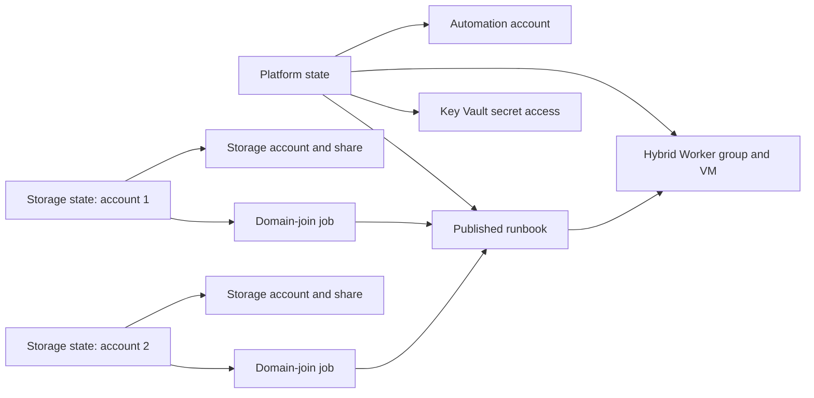

# Azure Files AD DS domain join

This project contains two Terraform deployments. The first creates an Azure Automation account and Hybrid Runbook Worker that can perform Azure Files domain joins. The second is a reusable template for deploying domain-joined Azure file shares.

## Problem statement

Customers often deploy cloud infrastructure as code (IaC), but end-to-end automation becomes more difficult when a deployment depends on operations outside the infrastructure control plane. Azure Files with Active Directory Domain Services (AD DS) authentication is one such scenario: Terraform can create the Azure resources, but completing the configuration also requires a domain join against AD DS.

The execution environment adds another constraint. Hosted CI/CD runners are commonly Linux-based and cannot perform the Windows PowerShell and domain-connected operations required by `AzFilesHybrid`.

This repository demonstrates one way to bridge that gap. A shared Azure Automation account dispatches the domain-join runbook to a domain-joined Windows Hybrid Runbook Worker. The Automation account uses managed identity to retrieve delegated domain-join credentials from Azure Key Vault, and the Hybrid Worker performs the AD DS and Azure Storage configuration. The result is a repeatable IaC workflow for deploying domain-joined Azure file shares without requiring the Terraform runner itself to be Windows-based or domain-joined.

This code is a proof of concept and should be reviewed against each organization's identity, networking, policy, monitoring, and least-privilege requirements before production use.



## Project layout

| Path | Responsibility | Deployment frequency |
| --- | --- | --- |
| `modules/automation-platform` | Automation account, runbook, Key Vault RBAC, worker identity, worker registration, and VM extensions | Once per shared platform |
| `modules/storage-account-domain-join` | Storage account, SMB share, scoped RBAC, readiness delay, and Automation job | Once per storage account |
| `deployments/platform` | Deployable root for the shared platform module and its resource group | Once, then only for platform updates |
| `deployments/storage-account` | Deployable root for one storage account; discovers the shared platform identities from Azure | Reused with separate state per account |
| `runbooks` and `scripts` | PowerShell runbook, worker bootstrap, and AzFilesHybrid join implementation | Published by the platform deployment |

The storage deployment does not read the platform Terraform state. It discovers the Automation account and worker VM through Azure data sources. This keeps the state files independent and permits a storage account to be destroyed without deleting the Automation account, runbook, worker group, or VM extensions.

## State boundaries

The two deployment roots are deliberately independent Terraform configurations:

| State | Working directory | Owns |
| --- | --- | --- |
| Platform | `deployments/platform` | Automation account, runbook, Key Vault RBAC, Hybrid Worker group and registration, worker VM identity update, and two worker VM extensions |
| One storage deployment | `deployments/storage-account` | One storage resource group, storage account, file share, account-specific RBAC, readiness timer, and one Automation job |

Never run Terraform from the repository root. Never copy a platform state into the storage deployment or import storage resources into the platform state. The storage configuration reads shared resource properties from Azure data sources, not from the platform state.

For production, configure encrypted AzureRM backends with a different state key for the platform and every storage account. For local POC use, the two working directories already produce separate local state; use a unique Terraform workspace for each storage account.

Example state names:

```text
azure-files-domain-join/platform.tfstate
azure-files-domain-join/storage/stfilesapp001.tfstate
azure-files-domain-join/storage/stfilesapp002.tfstate
```

## Part 1: Prepare the Automation platform

Deploy this part once. Do not repeat it for each storage account.

### 1. Prepare the existing Windows worker

Provide an existing Windows Azure VM that:

- Runs a supported Windows Server release with Windows PowerShell 5.1 and .NET Framework 4.7.2 or later.
- Has at least two CPU cores and 4 GiB of memory.
- Is a domain-joined member server, not a domain controller.
- Resolves the AD DS domain and reaches a writable domain controller.
- Allows outbound HTTPS to Azure Resource Manager, Key Vault, Storage, PowerShell Gallery, GitHub, and `*.azure-automation.net`.
- Is running while Terraform installs or removes VM extensions and while domain-join jobs execute.

Terraform enables a system-assigned managed identity while preserving existing user-assigned identities. It installs:

- `AzureFilesDomainJoinBootstrap`, which adds `RSAT-AD-PowerShell`, `Az.Accounts`, `Az.KeyVault`, `Az.Resources`, `Az.Storage` 8.1.0 or later, and `AzFilesHybrid` 0.3.2.
- `HybridWorkerExtension`, which registers the VM as an extension-based Windows Hybrid Runbook Worker.

### 2. Prepare Key Vault credentials

Create or select an existing Key Vault that uses the Azure RBAC authorization model. Add two secrets:

| Secret | Required value |
| --- | --- |
| Username | Delegated AD DS account in `DOMAIN\\username` or `username@domain` format |
| Password | Password for that delegated account |

Do not put either secret value in `terraform.tfvars`. Terraform receives only the vault name and secret names. After creating the Automation account, Terraform grants its managed identity `Key Vault Secrets User` on each individual secret.

The Key Vault firewall, private DNS, and routing must allow the worker VM to reach the vault.

### 3. Delegate AD DS permissions

Grant the delegated account only the rights needed in the target OU. For a computer account, this normally includes:

- Create and update computer objects.
- Set or reset the object password.
- Write the CIFS service principal name.
- Write the AES Kerberos encryption attributes.

The account must also be allowed to run a scheduled task on the worker VM and must not be denied batch logon by local policy or Group Policy. Do not use Domain Admin for routine joins.

### 4. Prepare the deployment identity

The identity running Terraform needs permission to:

- Create the platform resource group and Automation resources.
- Assign Azure roles at the two Key Vault secret scopes.
- Update the existing VM identity and extensions.

Role assignments generally require `Role Based Access Control Administrator`, `User Access Administrator`, or equivalent permission at the affected scopes.

Authenticate and select the intended subscription before running Terraform:

```powershell
az login
az account set --subscription "<subscription-id>"
az account show --query "{subscription:name,id:id,tenantId:tenantId}" --output table
```

### 5. Configure platform variables and state

Work only from the platform root:

```powershell
Set-Location .\deployments\platform
Copy-Item .\terraform.tfvars.example .\terraform.tfvars
```

Edit `terraform.tfvars` with:

- Subscription, region, and a dedicated platform resource-group name.
- Automation account, runbook, and Hybrid Worker group names.
- Existing worker VM resource group and VM name.
- Existing Key Vault resource group, vault name, and secret names.

For a local POC, `terraform init` creates local platform state only in this directory. For a remote backend, configure a dedicated platform key such as `azure-files-domain-join/platform.tfstate`; do not reuse any storage-account key.

### 6. Deploy the platform

```powershell
terraform init
terraform fmt -check -recursive
terraform validate
terraform plan -out="platform.tfplan"
terraform apply "platform.tfplan"
terraform output
```

The platform deployment creates the Automation account and system identity, publishes the runbook, grants secret access, configures the worker VM, and registers the Hybrid Worker.

### 7. Verify the platform

Confirm that:

- The Automation account and `Join-AzureFilesToDomain` runbook exist.
- The Hybrid Worker group shows the Windows worker as active.
- The VM has `AzureFilesDomainJoinBootstrap` and `HybridWorkerExtension` in a succeeded state.
- The Automation identity has `Key Vault Secrets User` on both named secrets.
- `terraform output` returns the Automation account, runbook, worker group, and worker principal IDs.

Keep this state for the lifetime of the shared platform. Applying script changes from this directory republishes the runbook or updates the bootstrap extension without changing any storage-account state.

## Part 2: Deploy a domain-joined Azure file share

Repeat this part for each new storage account. The shared platform from Part 1 must already be healthy, and the worker VM must be running.

### 1. Choose an independent storage state

Each account must have its own state identity. Do not deploy two storage accounts into the same workspace or remote backend key.

For local POC state:

```powershell
Set-Location ..\storage-account
terraform init
terraform workspace new stfilesapp001
```

If the workspace already exists, select it instead:

```powershell
terraform workspace select stfilesapp001
```

For an AzureRM backend, configure a unique key such as `azure-files-domain-join/storage/stfilesapp001.tfstate`. Use another key for the next account.

### 2. Configure account-specific variables

Create a variable file whose name matches the account or workload:

```powershell
Copy-Item .\terraform.tfvars.example .\stfilesapp001.tfvars
```

Set the following groups of values:

- Shared platform lookup: Automation resource group and account name, runbook name, Hybrid Worker group, worker VM resource group and name, Key Vault name, and secret names. These must match Part 1.
- AD DS registration: domain FQDN, target OU distinguished name, account type, and a unique SAM account name without a trailing `$`.
- Storage deployment: a dedicated storage resource group, globally unique storage account name, replication type, network-access setting, share name, quota, and tags.
- Invocation: an initial `invocation_token`, such as `run-001`.

The storage account name must contain 3-24 lowercase letters or numbers. The SAM account name must be unique in AD DS, contain no trailing `$`, and be no more than 20 characters.

### 3. Review and deploy

Verify the selected workspace before planning:

```powershell
terraform workspace show
terraform fmt -check -recursive
terraform validate
terraform plan -var-file="stfilesapp001.tfvars" -out="stfilesapp001.tfplan"
terraform apply "stfilesapp001.tfplan"
terraform output
```

The storage deployment:

1. Creates the storage resource group, storage account, and SMB file share through the Azure Resource Manager management plane.
2. Grants storage-account `Contributor` to the Automation and worker VM identities.
3. Grants the worker VM identity `Reader` on the storage resource group.
4. Waits for account-specific RBAC propagation.
5. Submits an immutable Automation job to the shared runbook and Hybrid Worker group.
6. Creates the matching AD DS object and enables Azure Files AD DS authentication.

Terraform waits for the submitted Automation job request, but use `automation_job_portal_url` to inspect the final job output and error streams.

### 4. Verify the domain join

Confirm that:

- The Automation job completed successfully on the expected Hybrid Worker.
- The storage account reports AD DS as the Azure Files identity source.
- The configured SAM account name and domain properties are correct.
- The matching computer or service-logon object exists in the requested OU with its CIFS SPN.
- The SMB share exists with the expected quota and network accessibility.

Share-level and NTFS directory/file permissions are separate from domain registration and must be assigned for users or groups before clients can access data.

### 5. Retry a failed join

Automation job IDs are immutable. After correcting the failure, increment `invocation_token` in the same account variable file, for example from `run-001` to `run-002`, and apply from the same workspace or backend key.

The job UUID also changes when join parameters, account-specific RBAC readiness, or the shared-key prerequisite changes. The runbook exits successfully without recreating the AD object when the storage account is already configured with the expected SAM account.

### 6. Deploy another account

Create another variable file and select a new workspace or backend key:

```powershell
terraform workspace new stfilesapp002
terraform plan -var-file="stfilesapp002.tfvars" -out="stfilesapp002.tfplan"
terraform apply "stfilesapp002.tfplan"
```

This creates another independent storage state while reusing the Automation account, published runbook, Key Vault credentials, and Hybrid Worker.

## Security choices

- Local-user access is disabled. Shared-key access remains enabled because AzFilesHybrid must create and rotate the storage account's `kerb1` and `kerb2` keys. These keys become the AD DS object's password and are not used by this project for file-share data access.
- The mandatory `SecurityControl = "ignore"` tag prevents the environment's policy from changing the requested storage network setting.
- SMB 3.1.1, AES-256 Kerberos tickets, AES-256-GCM channel encryption, HTTPS-only traffic, and TLS 1.2 minimum are configured.
- Storage public network access defaults to disabled. Enable it only when the public endpoint is required and reachable from the worker and clients.
- The Automation account public endpoint remains enabled because Private Link topology is outside this POC.
- Storage-account `Contributor` is broader than a production custom role. AzFilesHybrid requires storage account read/write and key-list/regeneration actions; replace Contributor with an approved least-privilege custom role for production.
- Use encrypted remote state with narrowly scoped access. Do not commit populated variable files, state, or saved plans.

## Destroy boundaries

Always select the intended storage workspace or backend key and use its matching variable file before destruction:

```powershell
Set-Location .\deployments\storage-account
terraform workspace select stfilesapp001
terraform plan -destroy -var-file="stfilesapp001.tfvars" -out="stfilesapp001-destroy.tfplan"
terraform apply "stfilesapp001-destroy.tfplan"
```

Destroying an individual storage state removes only that account's resource group, storage resources, share, scoped RBAC, and local job tracking. It does not remove the shared Automation platform.

The AD DS object created by AzFilesHybrid is external to Terraform and is not removed automatically. Delete that object separately after destroying its storage account, or use a new unique SAM account name for a replacement deployment.

Destroy the platform state only after every dependent storage deployment has been removed or migrated. The worker VM must be running while Azure removes its Terraform-managed extensions. Platform destroy removes the extensions and Hybrid Worker registration but does not delete the existing VM or Key Vault.

## References

- [Enable AD DS authentication for Azure Files](https://learn.microsoft.com/azure/storage/files/storage-files-identity-ad-ds-enable)
- [Deploy an extension-based Hybrid Runbook Worker](https://learn.microsoft.com/azure/automation/extension-based-hybrid-runbook-worker-install)
- [Run runbooks on a Hybrid Runbook Worker](https://learn.microsoft.com/azure/automation/automation-hrw-run-runbooks)
- [AzFilesHybrid 0.3.2](https://github.com/Azure-Samples/azure-files-samples/releases/tag/v0.3.2)
- [Terraform language style](https://developer.hashicorp.com/terraform/language/style)
- [AzureRM provider documentation](https://registry.terraform.io/providers/hashicorp/azurerm/latest/docs)
