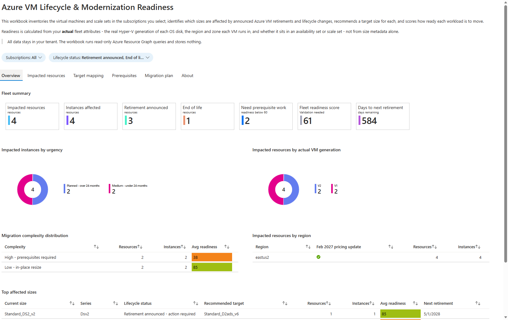
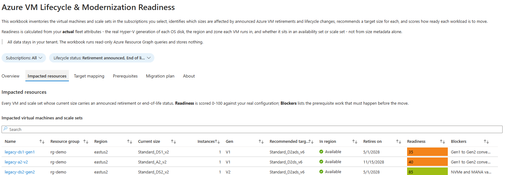
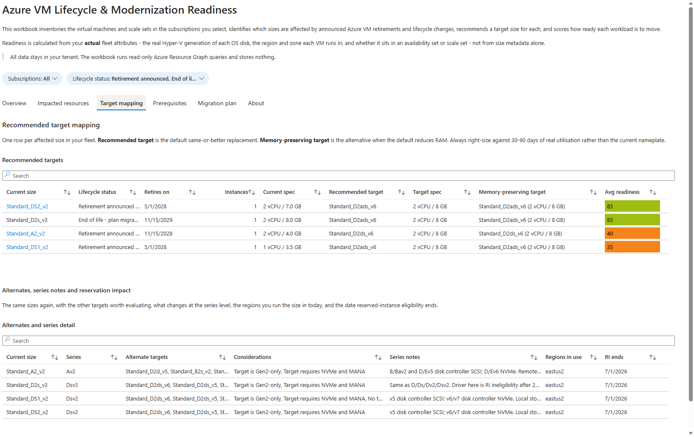
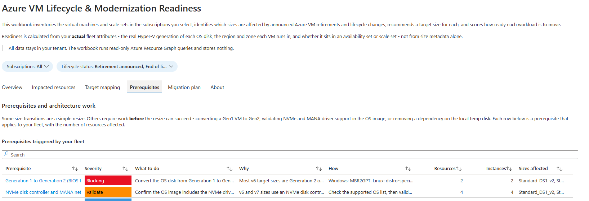
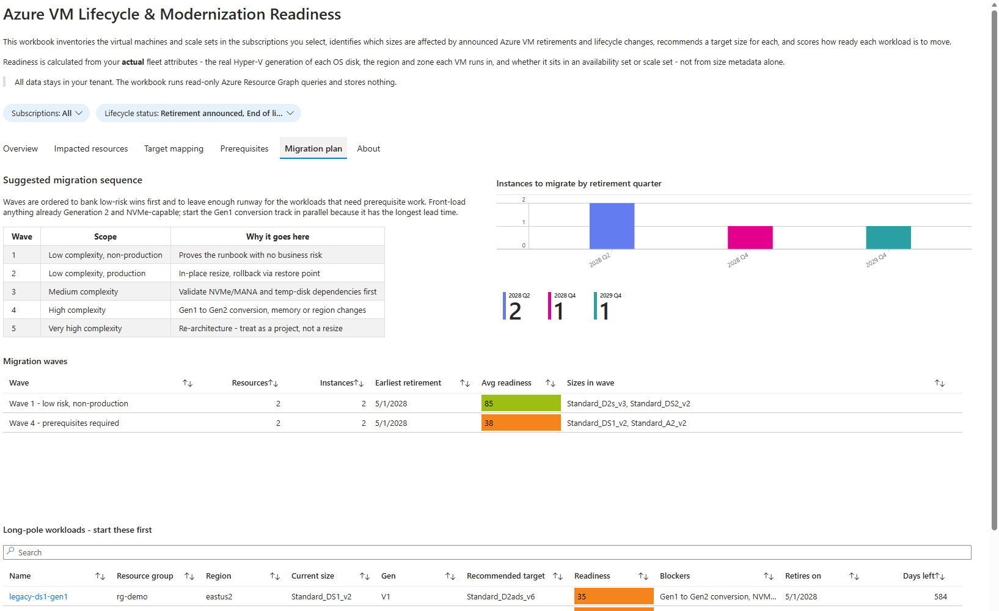
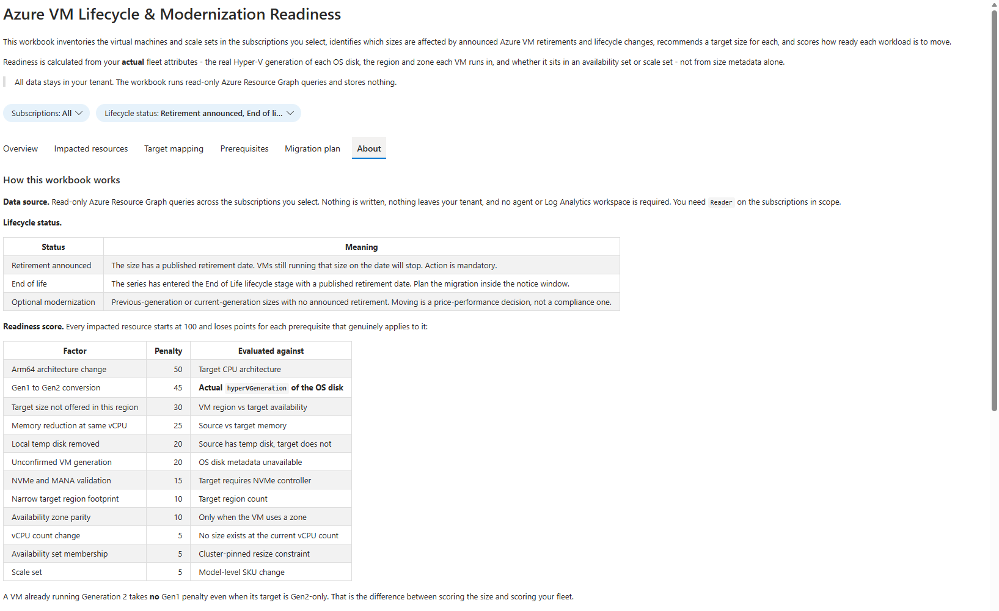

# Azure VM Retirement & Upgrade Planner

[](https://opensource.org/licenses/MIT)

A self-service Azure Monitor Workbook that inventories your VM fleet,
flags every size affected by announced Azure VM retirements and lifecycle changes,
recommends a target size for each, scores platform compatibility against the fleet's
**actual** configuration, and separates observed prerequisites from unverified migration readiness.

**A score of 100 is not migration approval.** It means no scored platform penalty;
guest drivers, application dependencies, HA, backup and rollback may still be unverified.

Modelled on the Azure Advisor *Service Retirement* workbook, but VM-specific and
with target mapping plus readiness scoring that Advisor does not provide.

## Self-contained deployment and runtime

The template deploys **exactly one Azure Monitor workbook resource**. There is no
Log Analytics workspace (LAW), customer-created table, storage account, Function,
Automation account, backend, agent installation or ingestion pipeline to provision.
Catalogue lookups, migration routes and checklists are embedded in the saved workbook.
No community tools or external catalogue feeds run when customers open it.

The workbook is **not offline**: customers need authenticated Azure control-plane
access and read permissions for the subscriptions and resource types they inspect.
It reads Azure's built-in Resource Graph tables (including `QuotaResources`,
`AdvisorResources`, `BatchResources` and `DesktopVirtualizationResources`) and
the existing read-only Compute SKU, Batch pool, Reservations, management-group and quota-group ARM endpoints. Reservation
visibility requires reservation-level permissions, separately from subscription Reader. Those built-in
tables are Azure-managed indexes, not tables the customer must deploy.
Missing permissions, index gaps and failed APIs are not a pass.
Microsoft Learn/portal hyperlinks are optional reference/navigation links, not
runtime data feeds. GitHub hosts the initial deployment template; customers can
also download/import the standalone workbook/template without ongoing GitHub access.

`scripts/validate_queries.py --offline` and the regression suite enforce the
one-resource deployment boundary, embedded reference values, permitted read-only
API endpoints, ARG-only KQL and local workbook merges. LAW queries, remote
lookups/shared queries, supporting resource dependencies and remote active
content are rejected. Build-time Python and repository reference files are
authoring dependencies only; customers do not install them to use the workbook.

[](https://portal.azure.com/#create/Microsoft.Template/uri/https%3A%2F%2Fraw.githubusercontent.com%2Fcjasset%2FAzureStuff%2Fmain%2Fworkbooks%2Fazure-vm-retirement-upgrade-planner%2Fworkbook%2Fazuredeploy.json)

## Origins and acknowledgements

This planner originated from [Krishna Sunkavalli's VM retirement workbook](https://github.com/krishna-sunkavalli/vm-retirement-workbook).
Thank you to Krishna for the original workbook, catalogue and target-mapping foundation.
The original MIT license and copyright notice are preserved in [LICENSE](LICENSE).

The planner is now independently maintained in
[cjasset/AzureStuff](https://github.com/cjasset/AzureStuff/tree/main/workbooks/azure-vm-retirement-upgrade-planner).
Its guided inventory, assessment, availability, quota, reservation and workload-specific
planning workflow has substantially expanded beyond the original workbook. This is
not an official Microsoft migration certification or an upstream-supported release.

The complete source history, including original author commits, was imported without
squashing into this folder. The [previous maintained fork](https://github.com/cjasset/vm-retirement-workbook)
remains available for historical references; new development belongs here.

## Target-selection policy: v5 first

The planner prefers a **catalogued, non-NVMe v5 target** for retirement remediation, rather than
defaulting directly to v6. Candidates must preserve CPU architecture, vCPU and
memory capacity, local-disk presence/known capacity and premium-storage support. Only existing
target records are eligible; SKU names are not invented by replacing a suffix.

The target specifications, memory-preserving target, regional lookup and readiness
warnings are derived from the selected target together. For example, DS1_v2 and
D2s_v3 now recommend **D2ds_v5**, which retains local storage and supports Gen1/Gen2.
They no longer inherit the Gen2-only/NVMe penalties of the original D2ads_v6 target.
V6 and V7 have independently assessed paths where captured compatible candidates
exist, requiring their own boot-controller and prerequisite validation.

If no suitable v5 candidate exists in the captured catalogue, the newer target
remains visible with **manual review required**. Existing non-NVMe recommendations
such as modern B-series are retained. Optional modernization is separate and may
still suggest a newer generation for a VM that is not retiring.

**V5 is not a compatibility guarantee.** MANA/accelerated networking is evaluated
independently of NVMe and may apply to v5 SCSI hardware. Guest OS, ADE/encryption,
drivers, disk/NIC limits, storage performance, application behavior, quota,
subscription restrictions and availability still need independent validation.
The source catalogue is a historical subscription snapshot, not live eligibility.
The original screenshots and score examples below describe the upstream baseline,
not the regenerated v5-first recommendations.



<sub>Screenshots are from a four-VM demo tenant built to exercise the scoring: two
Gen1 VMs, one Gen2 VM and one v3 end-of-life VM.</sub>

---

## What you get

The default landing page is **Start here**. Follow the numbered stages, or jump
directly to a stage and use its report selector. Each stage explains its goal,
actions, interpretation, checkpoint and next step. Report selections are
independent, so returning to a stage retains its current report during the session.
The workflow uses a new navigation parameter, rather than reusing legacy
`SelectedTab` report values that could otherwise hide every stage after an upgrade.
`WorkflowStage` is declared **global** so footer Next, Previous, Recheck and Help
actions update the stage visibility and top tabs above them. Report selectors
remain local. A non-global parameter only propagates downstream in Workbooks and
cannot support these footer actions.

| Stage | Reports and outcome |
| --- | --- |
| **Start here** | Scope, permissions, workflow map, evidence limitations and expected outputs |
| **1. Inventory** | Fleet overview; Retirement & pricing; Reservation exposure; Workloads & owners; Catalogue coverage. Produce a scoped workload list, visible purchased reservation exposure and explicit unassessed SKUs |
| **2. Assess** | V5 / V6 / V7 paths; Routes & gates; Required actions; SQL opportunities. Produce candidate paths and a prerequisite/evidence backlog |
| **3. Plan** | Live target availability; Capacity & quota; Target specifications; Compatible alternatives; Suggested waves. Produce target-access and quota actions, pilots, dependency-aware waves and a recovery plan |
| **4. Migrate & validate** | Route-specific runbook guidance and workload-specific done criteria, plus pilot, backup/restore, rollback, application/performance/HA checks and source closeout |
| **Methodology & references** | Recommendation policy, scoring model, sources and limitations; always accessible without advancing the workflow |

This is **guidance, not an execution engine or completion tracker**. Maintain
owners, decisions and approvals in your own exported plan. A green check applies
only to its specific evidence; Unknown is not a pass. Empty grids and disappearing
resources do not prove absence, successful migration or application readiness.
The detailed report descriptions below retain their familiar names.

### Platform score, commercial signals and assessment layout

#### Purchased reservations

**Inventory > Reservation exposure** lists actual purchased VM reservation records,
including reservations with no currently deployed matching VM. This is separate
from Fleet overview's **series commercial signals**, which are not purchase records.

The default shows retiring/EOL sizes, series RI purchase/renewal cutoffs, captured
series/regional pricing signals and **unassessed SKUs requiring manual review**.
Choose **All visible VM reservations** to inspect other VM reservations. Expired,
cancelled and archived records remain visible when returned by the API; inspect
state and expiry rather than treating historical records as active financial exposure.
Columns show reservation name, reserved SKU, region, quantity, actual expiry,
state and exposure. **Details** includes term, auto-renew, applied scope,
purchase date, reservation ID and each captured lifecycle/commercial signal.
This is not a utilization report, monetary loss estimate or attribution of RI
benefits to individual VMs; size flexibility and shared scope require billing review.

The native read-only Reservations API is **current-tenant and access-limited**,
not filtered by the workbook's VM subscription or lifecycle selection. Subscription
Reader alone does not establish reservation visibility. See
[reservation permissions](https://learn.microsoft.com/azure/cost-management-billing/reservations/view-reservations).
**No records is not proof no reservations exist.** The coverage table distinguishes
missing/malformed responses, empty pages and continuation. Browse **Next reservation
page** through the API's returned continuation links, including pages with zero
impacted matches. **Return to first reservation page** restarts browsing. Each page
requests 100 records; results are not silently presented as a tenant-wide total.
Failed or unsupported continuation stays explicit. No collector, custom table,
reservation purchase or reservation modification is required.

#### Platform and series signals

Inventory includes an on-page score/penalty key and all four score bands:
**85-100 Few**, **60-84 Moderate**, **35-59 Substantial**, **0-34 Major scored
platform changes**. Only populated bands appear in the distribution. A high score
means few captured platform penalties, not completed guest/application checks.
Gen1, Server 2016 and ADE are not penalized merely for existing if the selected
target does not require the affected conversion route.

The adjacent commercial key distinguishes legacy-series pricing, RI
purchase/renewal cutoffs and separate regional exposure. None reads customer
reservation expiry, current billing or negotiated rates.

Assess stacks independent **full-width V5, V6 and V7 panels**. Each compact grid has
eight visible columns; **ChecksNotMet** and **ChecksUnknown** count all 22 checks,
not just the three directly displayed status columns. Select **All 22 checks** for
the resource's vertically listed statuses and evidence in the native details view.
Export retains every prerequisite as its own column. An on-page dictionary
explains each prerequisite and the four states. Zero mismatches with unknown
evidence is not approval.

### Guided routes, gates and acceptance

**Routes & gates** pairs observed ownership/encryption/appliance/placement evidence
with five distinct guide selections: same-VM resize, parallel replacement,
service-owned replacement, Gen1 to Trusted Launch and SCSI to NVMe. The last two
are separate operations, not interchangeable names for a resize. Selections
change session-local guidance only, not a VM's target, readiness or saved approval.

The gates explain ADE's independent 15 September 2028 retirement, OS/data and
Windows/Linux scope, new-disk/new-VM encryption-at-host migration, Linux OS
decryption limits and persistent UDE history. They link the supported procedure
rather than embedding risky disk-copy commands. Selected publisher matches are
**suspected** network/storage/backup appliance evidence, not proof; generic
Marketplace/custom images remain unclassified until product/version certification
is confirmed. Placement details include zones, availability sets, Dedicated Host/
host groups, PPGs and capacity reservations; absent associations are not target approval.

Migrate & validate has separate acceptance criteria for standalone apps,
AKS/VMSS/Batch pools, **AVD pooled versus personal**, Databricks, SQL/SAP/stateful
systems and appliances. Unclassified is not stateless. Common checks cover
OS-disk application state, stable disk identifiers, local NVMe initialization,
pagefile/swap/tempdb/scratch, signed/current filter drivers, DNS/LB/routes,
identity/permissions, post-cutover writes and real recovery capacity. Closeout
requires restored backup/security/monitoring, licensing review and updated
Terraform/Bicep/images/autoscale/runbooks so retired sizes are not recreated.

The small compatible-alternatives shortlist preserves V5-first recommendations;
it exposes architecture separately from CPU vendor and quota CPUs separately
from effective CPUs. Unsupplied vendor/effective/local-capacity facts stay Unknown.
It is not service node-type certification or utilization-based right-sizing.

Start here identifies captured catalogue/quota-map dates and lifecycle overrides.
Near-findings evidence keys distinguish indexed ARG, live ARM and customer-confirmed
guest/workload evidence. Official Current/Extended/End-of-life/Retired vocabulary
is explained separately from internal RETIRE/EOL/OPTIONAL actions: OPTIONAL does
not assert Current, and a retirement announcement does not mean already retired.
Catalogue coverage also lists native Advisor Compute retirement-text candidates
for reconciliation with official lifecycle and Service Health; this optional view
is neither exhaustive nor an automatic reclassification feed.

### Workload discovery and live target availability

Compute associations use AKS node resource groups, Databricks/managed-application
managed resource groups, resource-group `managedBy`, and AVD session-host VM links.
SQL registration/extension and SAP extension/image/license signals are kept separate
from proof of running software. Multiple owner associations require review.
Unclassified compute is **not assumed stateless or low complexity**.

NIC configuration/counts, shared disks, ephemeral/unmanaged disks, hibernation,
security type, system-assigned identity and Marketplace plans identify assessment
or rebuild dependencies, not blanket resize blockers. Incomplete NIC/disk
visibility stays Unknown. Flexible member details and service/pool registrations
must **not** be summed with model capacity.

Independent service inventory retains services with no visible backing VMs.
The ownership view separates observed subscription VM/VMSS rows from
**Service-owned pool configurations**, shown immediately underneath. In Batch
service allocation mode, pool VMs are in Microsoft-managed subscriptions and
cannot appear as local Compute ownership rows. Batch ownership, configured
sizes, lifecycle and pool/task migration guidance are shown in the pool
table when Resource Graph indexes the pools, including at zero nodes; these
records are not additional fleet VMs. Resource Graph can omit existing Batch
pools. Select a Batch account in **Independent service registrations** to open
**Live Batch pools (ARM)**, a direct read-only pool listing independent of ARG
indexing. It shows configured sizes, dedicated/Spot counts and autoscaling
formulas; it does not apply the ARG lifecycle map. Empty results or API errors
are not proof of zero pools; check selection and pool-read permissions.
AVD host-pool type and configured AKS/Batch pool demand are exposed. Autoscaler
maxima, surge, Batch service quotas and transient/serverless compute are **not**
automatically incorporated into the existing Compute VM/VMSS quota calculation.

OS eligibility hints use a deliberately limited subset of the official
[NVMe image list](https://learn.microsoft.com/azure/virtual-machines/enable-nvme-interface)
and [MANA OS/kernel guidance](https://learn.microsoft.com/azure/virtual-network/accelerated-networking-overview),
checked 18 November 2026. Other versions/distributions remain Review, not unsupported.
Observed guest OS takes precedence over image labels. Hints never mark boot,
driver or traffic validation Met. Windows Server 2019 shared-disk NVMe compatibility
requires separate review.

In **Plan > Live target availability**, choose V5/V6/V7 and select a distinct
**subscription / region / zone / target SKU combination**, rather than a VM.
Affected resource/instance counts show the shared scope. Regional means no zone
was specified, not all-zone support. Multi-zone scale-set models contribute a row
for each declared zone; their resource counts repeat and per-zone instance counts
remain Unknown (blank), so these rows must not be summed as fleet capacity.
Missing or invalid model capacity likewise keeps the entire combination's
instance count Unknown, not zero.

The default result is customer-facing, not JSON:

The live request and dependent summary can take a few seconds after selection.
An initial **Unknown** may clear automatically; wait briefly before retrying.
If it persists, verify selection and permissions rather than treating it as a pass.
The workbook does not impose an artificial delay or hide genuine Unknown results.

| SKU access | Meaning | Next action |
| --- | --- | --- |
| **Green - Not restricted** | The selected region/zone is advertised and no applicable access restriction was returned | No access ticket indicated; continue with quota, policy and migration checks |
| **Red - Restricted** | A location or zone restriction applies to this subscription and placement | Use the support link to request SKU region/zone access; a quota-coded restriction instead needs a quota increase |
| **Amber - Unknown** | Missing/failed/malformed evidence, an unadvertised placement or a restriction that cannot be safely interpreted | Retry, verify permissions/placement and contact support if unresolved; never assume clear |

A restriction for another region or zone does not make the selected placement
red. Zone-only restrictions do not block an unzoned regional placement.
**Green is SKU access only**, not a guarantee of quota, policy approval or
physical allocation capacity. Support does not guarantee access or allocation.

The default page shows a short purpose/legend, placement selection and access result.
**Result detail** optionally opens **Resource capability checks**, the
**Placement key & interpretation**, or **Advanced raw evidence**, rather than
stacking all three on the page. Detailed procedures are linked to public documentation.

**Advanced raw evidence** is opt-in. The same read-only Compute SKU response
feeds both views: a hidden native Merge text parameter reuses the full SKU
record, then one ARG query evaluates the restrictions. No second customer click,
new service or additional ARM SKU request is required. The record's JSON can
arrive as an object or JSON string; both are normalized and missing data stays
Unknown. The summary and raw evidence preserve the selected placement context.
This inspector does not overwrite catalogue recommendations or prerequisite statuses.
Per-resource quota prerequisites remain Unknown: use **Plan > Capacity & quota** and its
matching Default V5-first, V5-only, V6-only or V7-only scenario. A missing compatible
target stays Unknown instead of falling back to another generation. Scenario
selection changes quota modelling only, not the Inventory recommendation.

The same live SKU record also powers compact **per-resource capability details**:
attached data disk/NIC counts against target ceilings, provisioned attached-disk
IOPS/MBps, target cached/uncached IOPS/MBps, architecture/manufacturer and quota/
effective CPUs. Select Details or export for the full evidence; no extra ARM
request is introduced. Incomplete attached-disk/NIC visibility, missing/duplicate
limits and VMSS instance uncertainty cannot become green count checks.
Provisioned ceilings are not observed demand; cached and uncached paths are not
additive. Performance/guest/vendor/placement validation stays Unknown.

The About coverage table explicitly retains SKUs outside the captured catalogue
as **Not assessed**. Absence from the impacted table does not establish that an
unmapped resource is unaffected.

### Impacted resources

The **VM retirement / end of life** section respects the Lifecycle status filter
but always excludes optional modernization. The **Potential regional price exposure**
section is independent of that filter and the retirement catalogue: modern v5/v6
VMs can be listed without being classified as retiring. A resource can appear in
both sections. Overview summary counts continue to describe retirement, not the
union of financial and lifecycle signals.

Regional figures are **publicly reproduced notification information**, not a
confirmed tenant-specific increase: North Europe 17%, France Central/South 11%,
West Europe and Norway East/West 9%, Southeast Asia 8%, reportedly effective
1 February 2027. The [public Microsoft Learn Q&A source](https://learn.microsoft.com/en-us/answers/questions/6025662/is-there-any-official-announcement-for-azure-vm-in)
is a community post quoting a notification, **not a formal Microsoft announcement**.
Verify the authoritative Service Health advisory, in-scope meters, contract and
reservation treatment. The percentages are not an applied per-VM increase or a
bill forecast.

VMs in those regions are shown with either potential exposure, series/scope unknown,
or a **reported regional exclusion**. An exclusion is not a universal exemption
from other changes, particularly the separate legacy-series update. Unknown SKUs
remain unknown; only the explicitly named Intel v7 series are treated as reported
v7 exclusions, not every v7 family. Storage meters are not inventoried here.

### SQL modernization

The separate tab identifies retiring/end-of-life **VMs**, not SQL-looking names or
Marketplace images, joined by normalized VM ID to SQL VM registrations and/or
VM extension resources. Extension detection requires publisher
`Microsoft.SqlServer.Management` and handler `SqlIaaSAgent` (either ARG
handler-property representation). Both signals are aggregated to one VM row,
with registration/extension states, edition, license type, management mode and
group IDs preserved. Group registration does not prove active HA membership/health.
Stopped VMs and failed/unknown extension states remain assessment signals.

Flexible scale-set member VMs are evaluated individually for SQL discovery; the
scale-set model is not counted again. Uniform instances without individual ARG
VM/extension records are outside this query's coverage. Absence of a matching
extension or registration is **not proof SQL is absent**; permissions and ARG indexing also affect
coverage. The tab includes all retiring/end-of-life matches independently of the
global Lifecycle status selector.

Before recommending a destination, validate SQL instances/version/edition,
database compatibility, dependencies (jobs, linked servers, SSIS/SSRS), HA/DR,
storage performance, licensing and downtime. Evaluate Azure SQL Managed Instance,
Azure SQL Database or supported SQL on modern VMs based on that assessment.
The workbook does not inspect guest SQL services or certify a migration target.

### Original upstream screenshot

Sorted worst-readiness first, so the workloads that need the most lead time are at
the top. Note the two Gen1 VMs scoring 35 and 40 against the Gen2 VM at 85 — same
retirement, very different amount of work.



### Target mapping

`Standard_DS1_v2` is 1 vCPU / 3.5 GB and its recommended target is 2 vCPU / 8 GB —
the kind of spec jump that changes per-core licensing, which is why the current and
target specs sit side by side.



### Upgrade paths: stacked V5, V6 and V7 assessments

Select **Upgrade paths** to compare the same retiring resources in three stacked,
full-width panels. Each selects a target from that generation's captured catalogue; a missing
match is **manual selection required**, never a silent fallback to another generation.

- **V5:** a non-NVMe target preserving the source's required architecture, CPU,
  memory, local-disk presence/known capacity and premium-storage support. Do not
  force Gen1 conversion, an OS upgrade or decryption when the selected resize
  target does not require that conversion.
- **V6/V7:** independently evaluated Gen2/NVMe requirements. Gen1 conversion or a
  rebuild, OS eligibility, image/disk/boot-driver compatibility and actual boot
  rehearsal are called out where applicable. Unknown target local-disk capacity
  stays unverified, not assumed equal.
- **Every path:** MANA/accelerated networking is independent of the disk controller.
  Validate quota/restrictions/policy, zone/cluster availability, storage performance,
  disk/NIC limits, application behavior, recoverable backups and rollback.

The OS disk's ADE configuration is an observed **configuration signal**, not proof
of current guest BitLocker state. A Server 2016 image SKU is an **image hint**, not
proof that the guest has not since been upgraded. Custom/gallery lineage does not
prove a missing driver. These unknowns remain visible in every panel.

Windows OS/encryption and Backup/ASR prerequisites of the documented
Gen1-to-Trusted-Launch conversion are explicitly distinguished from an ordinary
resize or a rebuild. No guest inspection or migration is performed by the workbook.
Each panel exports the additional evidence columns; none displays a synthetic
"ready" score while guest compatibility is unverified.

Each prerequisite has its own **Met / Not met / Unknown / Not applicable**
column: target selection, generation, conversion OS/encryption, NVMe boot, MANA,
architecture, memory, local disk, catalogue region, zone, availability set,
scale-set model, disk/NIC limits, quota, policy, allocation capacity, backup,
ASR conversion, application validation and rollback. These columns remain in the
export; select **All 22 checks** for vertically listed per-resource details. The
compact grid's mismatch/unknown counts include every check. **Met** means only that the available evidence
satisfies that particular check; missing guest, placement, quota or application
evidence stays **Unknown**. The paths' quota column is not automatically certified
by the separate quota-planning assessment.

### Capacity / quota

Open **Plan > Live target availability** for SKU access and the separate
**Plan > Capacity & quota** report for fleet quota headroom.
Physical allocation capacity and workload readiness are separate
gates: neither green access nor sufficient quota guarantees allocation or migration success.
The live target combination does **not** filter fleet quota demand or change its
target scenario. Its list uses the workbook's selected subscriptions; quota's
**Planning scope** can independently include all readable tenant subscriptions.
Both pages keep their essential caveats visible. Quota's **Show detail** opens
one optional breakdown, shortfall/headroom table or **Column key & assumptions**;
the long key is hidden in the default summary view.

The default view has only **five visible columns**, with a total followed by
one row per subscription:

| Column | Meaning |
| --- | --- |
| Scope | The total or subscription name; IDs remain available in exports |
| Current cores | Configured retirement/EOL source quota-vCPUs, not all workload usage; includes deallocated inventory |
| Target cores | Their selected scenario's target quota-vCPUs in the current regions; default is V5-first |
| Delta (+/-) | Target minus current; a signed inventory difference, **not** the quota request |
| Quota status | Red if any required regional/family quota is insufficient; orange for unknown coverage; green means quota only |

Use **Planning scope** to switch between the workbook's selected subscriptions
and all subscriptions you can read in the current tenant. The latter is not a
claim of access to every tenant subscription. Other tabs keep their original
subscription scope. Lifecycle display filters do not remove retirement/EOL demand.
Scale sets use model capacity and Flexible members are not double-counted.
Use **Target scenario** to independently estimate the V5-only, V6-only or V7-only
compatible paths. Missing targets/CPU-family metadata remain Unknown and never
fall back to another generation. The selected generation is a quota model, not
an automatic migration approval or a change to Inventory recommendations.

- **In-place is the default** in the workbook and query-validation CLI. The
  explanation beside the selector distinguishes quota modelling from confirming
  that a resize is supported.
- **Side-by-side:** deploy replacements alongside the originals; the entire target fleet needs additional cores while sources
  remain allocated.
- **In-place regional:** sum positive target-minus-source core deltas, without
  granting negative credits for downsizing other resources.
- **In-place family:** positive deltas for same-family moves; full target cores
  for cross-family moves. Source credit requires a running/stopped allocation
  with known source CPU/family metadata. Deallocated, unknown or transitional
  states (including scale-set models without instance evidence), or missing
  source metadata, use **full target cores with no source credit** for both
  constraints. The result is labelled **conservative**, with numeric shortfalls.
  Existing usage is already deducted from limits, so this safe upper bound can
  overestimate demand. A shortfall concerns that conservative plan, not proof
  every optimized resize fails. Missing quota/target metadata and Spot remain
  explicitly Unknown rather than being presented as a pass.

Every affected subscription/region/family is checked **automatically** against
indexed Compute `QuotaResources` limits and usage, including the regional total
across all target families. Both constraints must pass. Totals retain every
individual shortfall; spare quota elsewhere cannot cancel one. Known failures
remain red even if other checks are unknown.

**Show detail** displays one optional table at a time:

- **Migration breakdown:** subscription, region, target family, current cores,
  target cores and delta. Extra arithmetic remains in exports, not the default UI.
- **Quota checks and shortfalls:** additional cores required by the chosen
  migration approach, available quota (limit minus all existing usage), shortfall
  and status. Shortfall is floored at zero; a blank means Unknown.
- **Tenant headroom / quota group discussion:** readable subscriptions with
  relevant target-family/region quota, even without affected source VMs.
  Available cores are capped by both family and regional headroom. This is
  unused quota **now**, not surplus after their planned migrations.

Headroom is a discussion lead, **not a shared pool**. The optional **Live
quota-group inspector** separately discovers readable management groups and their
quota groups using native ARM APIs. Select one group, subscription, region and
quota metric; this is a guided inspection, **not an automatic tenant-wide scan**.
It is independent of fleet scope and target scenario. Membership comes from the
quota-group API, never management-group ancestry.

Separate columns show verified membership, group limit, **unallocated group
cores**, quota already allocated to the selected subscription and the next action.
An unallocated pool must be allocated first; it never turns a subscription
shortfall green. Already allocated quota is not added to subscription limits again.
Discovery lists follow standard API pagination. Missing, invalid, duplicate,
pending or mismatched evidence stays Unknown; nested pool/allocation continuation
pages also remain Unknown rather than claiming complete coverage. Empty lists or
access errors do not establish that no group exists. Raw evidence is opt-in.
The inspector does not assess donor `shareableQuota`, subscription eligibility,
physical capacity or competing migration demand, and never creates groups,
changes membership, moves quota or requests increases. See
[quota groups](https://learn.microsoft.com/azure/quotas/quota-groups).
Quota-group read permissions are inherited from the owning management group;
subscription Reader access alone does not establish access to that group.

Select **Readable management group** first, then **Quota group**. Lists can take
a few seconds to load; a required-but-empty selection is not evidence that no
management group exists. Both dropdowns project `id`/`name` from the array-root
rows returned by native `GETARRAY`, not the REST response's `value` envelope.
Validation covers that binding and paged/empty list shapes as well as direct API access.

Missing CPU/family metadata, missing quota, or Spot workloads keep the relevant
estimate **Unknown**, not unlimited or zero shortfall. Duplicate quota metrics are
also Unknown. ARG indexing is eventually consistent: refresh and recheck using
Azure Quotas/CLI immediately before migration. The workbook does not request quota
increases. Quota **does not reserve physical capacity** or satisfy SKU/zone
restrictions, policy, boot/driver or application prerequisites. All-at-once estimates
are not a wave schedule. The SKU map uses actual `vCPUs`, not constrained-core
`vCPUsAvailable`.

### Prerequisites

Only the prerequisites that *this* fleet actually triggers, ranked Blocking first.
The Gen1-to-Gen2 conversion is the long pole and is surfaced as blocking.



### Migration plan



### About



## Interpreting the platform score

Most retirement tooling scores the **size**. This scores the **fleet**.

The workbook joins each VM to its managed OS disk and reads the real
`properties.hyperVGeneration`. A VM already running Generation 2 takes **no** Gen1
penalty even when its recommended target is Gen2-only, while a Gen1 VM heading for
the same target takes a 45-point hit and surfaces the BIOS-to-UEFI conversion as a
blocking prerequisite.

Validated against a live fleet: identical `RETIRE` sizes scored **95** on Gen2 VMs
and **35** on Gen1 VMs.

| Factor | Penalty | Evaluated against |
| --- | ---: | --- |
| Arm64 architecture change | 50 | Target CPU architecture |
| Gen1 to Gen2 conversion | 45 | Actual `hyperVGeneration` of the OS disk |
| Target size not offered in this region | 30 | VM region vs captured size catalogue |
| Memory reduction at same vCPU | 25 | Source vs target memory |
| Local temp disk removed | 20 | Source has temp disk, target does not |
| Unconfirmed VM generation | 20 | OS disk metadata unreadable |
| NVMe boot validation | 15 | Selected target requires NVMe controller |
| MANA/accelerated networking validation | 0 | Hardware-dependent, independent of storage controller |
| Narrow target region footprint | 10 | Target region count |
| Availability zone parity | 10 | Only when the VM uses a zone |
| vCPU count change | 5 | No target at the current vCPU count |
| Availability set membership | 5 | Cluster-pinned resize constraint |
| Scale set | 5 | Model-level SKU change |

Bands describe few (85+), moderate (60-84), substantial (35-59) or major
(under 35) **scored platform changes**, not application migration complexity.
The exported `ReadinessScore` field is retained for compatibility. Unknown
prerequisites do not become passed checks at 100. Suggested migration waves
remain platform triage suggestions requiring workload-owner approval.

---

## Resources vs instances
The two counts differ wherever a scale set is involved:

- **Resources** counts ARM objects. A scale set is one resource however large it is.
- **Instances** counts actual VMs. A scale set contributes `sku.capacity`.

A fleet of 12 resources and 400 instances means twelve pieces of work but four
hundred machines rebooting. Effort and change control size off Resources; quota,
cost and blast radius size off Instances.

### Flexible orchestration is counted once

A **Flexible** scale set surfaces in Azure Resource Graph twice over: the scale
set itself, carrying `sku.capacity`, *and* every member VM as its own
`microsoft.compute/virtualmachines` row. Counting both double-reports the fleet -
a 2-instance scale set reads as 3 resources and 4 instances.

The base query drops member VMs and lets the scale set represent them:

```kusto
| where IsVmss or isempty(tostring(properties.virtualMachineScaleSet.id))
```

**Uniform** scale sets never expose member VMs, so they were always counted
correctly. Flexible is the current Azure default, so this affects most modern
fleets.

---

## How environment is determined

Wave 1 is the no-risk pilot, so it only accepts workloads confirmed to be
non-production. Most fleets do not tag every VM, so environment is resolved
through a cascade and the workbook reports which signal it used:

| Order | Signal | Notes |
| ---: | --- | --- |
| 1 | Resource tag | `Environment`, `Env`, `Tier`, `Stage` or `Usage`, any casing |
| 2 | Resource group tag | Same keys on the parent resource group |
| 3 | Subscription tag | Same keys on the subscription |
| 4 | Dev/Test subscription offer | A Visual Studio or Enterprise Dev/Test subscription cannot host production under the Azure offer terms |
| 5 | Naming convention | `dev`, `test`, `qa`, `uat`, `sandbox`, `staging` in the subscription or resource group name. Read only as non-production, never as production, because a name is weaker evidence than a tag |

Values are normalised, so `non-prod`, `non_prod` and `nonprod` read alike.

**Anything the cascade cannot resolve is sequenced as production.** Guessing the
other way puts a production VM into a wave described as carrying no
business risk.

If a fleet has no environment signal at all, every low-complexity workload lands
in wave 2 and wave 1 is empty - which is the correct outcome, not a bug. One
`Environment` tag per resource group resolves the whole estate through step 2.

The **Environment** and **Signal** columns on the wave table show the verdict and
its source, so the classification is auditable rather than implicit.

### Worked example

A four-VM demo fleet where the resource group carries `Environment=Development`
and two VMs carry their own tag:

| VM | Own tag | Resolved | Signal |
| --- | --- | --- | --- |
| `legacy-ds2-gen2` | `Environment: Production` | Production | Resource tag |
| `legacy-d2s-v3` | `Environment: non-prod` | Non-production | Resource tag |
| `legacy-ds1-gen1` | *none* | Non-production | Resource group tag |
| `legacy-vmss-ds2v2` | *none* | Non-production | Resource group tag |

A resource tag always beats the group it sits in, and the two untagged VMs
inherit the group rather than falling through to *Unverified*.

### Why not just search the tags

An earlier version tested `tostring(Tags) has 'prod'`. That is wrong in both
directions, because KQL `has` matches whole terms:

| Tag | Old verdict | Why |
| --- | --- | --- |
| `Environment: Production` | Non-production | `"Production"` is not the term `"prod"` |
| `Environment: non-prod` | Production | tokenises to `[non, prod]` |
| `Product: prod-catalog` | Production | matched an unrelated tag |

The first row is the dangerous one: a production VM sequenced into wave 1.

---

## The queries

Every Azure Resource Graph query the workbook runs is documented verbatim in
[`docs/QUERIES.md`](docs/QUERIES.md) - 36 read-only ARG queries alongside native ARM inspectors, with the shared base
pipeline shown once and each per-tab tail alongside it. Nothing is hidden: you
can audit exactly what executes against your tenant before you deploy.

## Sharing the results

| Need | How |
| --- | --- |
| **Export a table to Excel** | Detail grids carry a **Download to Excel** toolbar button. It exports *all* columns, not just the visible ones, so the prose columns that truncate on screen come through in full. |
| **Print / PDF** | Workbooks have no native print command. Use the browser's own **Print → Save as PDF** (`Ctrl+P`). Expand the tab you want first; only the visible tab prints, because the other tabs are hidden by conditional visibility. |
| **Share the live view** | The toolbar **Share** button copies a URL that carries your parameter selections. The recipient needs `Reader` on the same subscriptions. |
| **Pin to a dashboard** | Individual charts and grids can be pinned to an Azure dashboard from the item's **Pin** control. |

There is no built-in "export the whole workbook to PDF" - that is a long-standing
Workbooks gap rather than something this workbook can add. For a point-in-time
artifact you can share, the Excel export per grid is the reliable path.

---

## Deploying it

### Option A - Deploy to Azure (recommended)

[](https://portal.azure.com/#create/Microsoft.Template/uri/https%3A%2F%2Fraw.githubusercontent.com%2Fcjasset%2FAzureStuff%2Fmain%2Fworkbooks%2Fazure-vm-retirement-upgrade-planner%2Fworkbook%2Fazuredeploy.json)

Pick a subscription and resource group, then **Review + create**. The workbook
appears under **Monitor → Workbooks**.

### Option B - Azure CLI

Run the following commands from this planner folder, not the AzureStuff repository root.

```bash
az group create --name rg-vm-lifecycle --location eastus

az deployment group create \
  --resource-group rg-vm-lifecycle \
  --template-file workbook/azuredeploy.json \
  --parameters workbookDisplayName="Azure VM Retirement & Upgrade Planner"
```

### Option C - Azure PowerShell

```powershell
New-AzResourceGroup -Name "rg-vm-lifecycle" -Location "eastus"

New-AzResourceGroupDeployment `
  -ResourceGroupName "rg-vm-lifecycle" `
  -TemplateFile "workbook/azuredeploy.json" `
  -workbookDisplayName "Azure VM Retirement & Upgrade Planner"
```

### Option D - paste the template (no resource created)

1. Azure portal → **Monitor** → **Workbooks** → **New**
2. Click the **</>** *Advanced Editor* button
3. Paste the contents of [`workbook/vm-lifecycle-readiness.workbook`](workbook/vm-lifecycle-readiness.workbook)
4. **Apply** → **Done Editing** → **Save**

### Permissions

To deploy, you need `Contributor` on the destination resource group (or a
custom role permitting deployments and `Microsoft.Insights/workbooks/write`).
`Reader` is sufficient to view queried resources, but not to deploy or save a
workbook. To use the workbook, you need `Reader` on every subscription in scope.
Quota checks use indexed Compute `QuotaResources` visible to the reader; absent
records are reported as Unknown. The workbook issues
**read-only** Azure Resource Graph queries, writes nothing,
needs no agent and no Log Analytics workspace, and no data leaves the tenant.

If a subscription grants read on `virtualMachines` but not on `disks`, the OS-disk
join returns nothing and those VMs show `VmGeneration = Unknown` with a 20-point
penalty and a "Confirm VM generation" prerequisite, rather than failing.

---

## Rebuilding

Run from `workbooks/azure-vm-retirement-upgrade-planner` within the AzureStuff checkout.
Build outputs and embedded references remain local to this folder.

```bash
python scripts/build_workbook.py      # regenerate workbook + ARM template
python scripts/build_queries_doc.py   # regenerate docs/QUERIES.md
python scripts/validate_queries.py --offline  # size, structure and published artifact checks
python -m unittest discover -s scripts -p "test_*.py"  # offline regression tests
python scripts/validate_queries.py    # all 36 live ARG queries in the current CLI subscription
# Optional quota scope / migration approach (CLI authorization scope remains --subscription):
# python scripts/validate_queries.py --subscription <id> --quota-scope tenant --migration-mode inplace --quota-generation 6
```

The current release uses an explicitly limited **metadata/API validation**
scope: 83 offline tests, all 36 live ARG queries plus 12 V5/V6/V7 quota-scenario
queries, standalone-dependency regression checks, 32 quota and pricing/SQL boundary
fixtures, 20 production-KQL quota-group cases, guided discovery API probes,
workload-discovery fixtures and exact live target-SKU records. Additional
ARG fixtures cover 20 score-factor cases, every integer score from 0 to 100,
nine placement cases on all three paths and all 22 prerequisite summary counts.
Capability tests evaluate the production KQL for 12 disk/NIC boundary/Unknown
cases, two attached-disk/placement/ADE/appliance fixtures and real selected
V5/V6/V7 SKU/compute combinations. A missing live SKU remains Unknown, not approval.
The access classifier is exercised with 38 synthetic cases, four captured F2/G1
placements and four complete-query parameter shapes (object/string/empty/null).
Only explicit ARG throttling is retried, at most twice with visible 30/60-second
delays; authentication/query errors and exhausted retries still fail validation. Fresh
SQL guest-runtime verification was not completed because the SQL lab VM's guest
agent did not report readiness during the earlier lab startup. No lab VM is
started for this reporting-only validation. Portal visual verification was
also not completed. SQL detection remains an assessment signal, not proof of a
running SQL service or application migration readiness.

`build_workbook.py` writes four files: the workbook and ARM template under
`out/` for local iteration, and published copies at `workbook/azuredeploy.json`
and `workbook/vm-lifecycle-readiness.workbook`. The published ARM template is
what the **Deploy to Azure** button resolves, so it must be committed for the
button to work.

Without `--offline`, `validate_queries.py` needs `az login` and the
`resource-graph` CLI extension. It
verifies that tab links match group visibility conditions, that every query is
scoped to `{Subscriptions}` and references only declared parameters, and that all
28 Resource Graph queries execute successfully. Live CLI validation is limited
to the current or explicitly supplied subscription; the workbook's tenant scope
uses the portal's readable subscriptions. Quota queries join indexed quota records
automatically, without selected-row parameters or per-family ARM requests. Azure Resource Graph throttles
aggressive callers, so an occasional single-query failure on a back-to-back run is
a rate limit rather than a regression - re-run to confirm.

### Source data

`references/sku-migration-map.json` is vendored into this repo so a fresh clone
builds without any sibling checkout. It carries 628 sizes - 137 retiring, 39
end-of-life, 452 optional - with targets, memory-preserving alternatives,
alternates and warning codes, and self-declares:

> PUBLIC - all lifecycle facts sourced from learn.microsoft.com. Contains NO
> pre-announcement pricing information.

`references/quota-families.json` captures 1,284 public Compute SKU family and
quota-vCPU mappings. It contains no subscription IDs, usage, quota limits or tenant
information. Refresh it from the Compute SKU API when adding sizes; preserve
the API's family casing for the workbook's case-sensitive JSONPath selection.
Live quota/usage is never embedded in the published artifacts.

Prerequisite copy and series lifecycle detail were originally separate reference
files; they are now inlined in `scripts/build_workbook.py` as the `PREREQ` and
series tables. `scripts/build_workbook.py` prefers the local `references/` folder
and falls back to a sibling `compute-fleet-modernization/references` checkout when
building from the authoring tree.

### Implementation notes

AKS registrations and Batch accounts are indexed in ARG `resources`, while
Batch pools are indexed in `batchresources`. Service and configured-pool
discovery unions both tables. Batch returns lower-case VM sizes, so configured
pool lifecycle matching is case-insensitive and retains the source VM-size
value. Compute inventory and quota planning do not add Batch-service nodes.

Azure Resource Graph supports neither `let` nor `datatable`, so the lifecycle
lookup is used in each query as a `parse_json('{...}')` dynamic literal indexed
by VM size. The lookup data is stored once in hidden workbook text parameters
and substituted before queries are sent to ARG. Warning codes use single
characters and region lists use hex indices into a shared region table.

Earlier builds repeated the lookups in every chart, exceeding the saved-workbook
size limit and failing with **"The workbook length is too large"** through both
ARM deployment and Advanced Editor save. The shared lookups preserve the full
628-size catalogue and all 36 ARG queries while keeping the saved workbook below
1 MB. Standalone workbook files are emitted compactly; both raw-file and saved-resource
sizes are validated. Rebuilds fail if that limit is reached; use the current published template
or workbook rather than an older downloaded copy.

### Layout conventions

Modelled on the official Advisor *Azure Services Retirement* workbook
(`reference/official-service-retirement.workbook`):

- **Tables use the full available page width**, including native ARM evidence
  tables. Half-width and pixel-capped table containers are not used; charts retain
  their existing layout.
- **Column widths use native fractional (`fr`) units**, not fixed character
  widths. Existing relative weights are preserved, with extra room for the
  Capacity & quota numeric headings. Columns share available width and retain
  the renderer's content-based minimums. Narrow windows or wide detail tables
  may still need horizontal scrolling; headings and values are not shortened
  to force a fit. See [native grid sizing](https://learn.microsoft.com/azure/azure-monitor/visualize/workbooks-grid-visualizations#fractional-unit-percentages).
- **Query `size` sets the grid height**, and `gridSettings.rowLimit` only caps how
  many rows the query returns - it does not make the grid taller. Measured
  heights: `size: 4` ~126px (3 rows, too cramped), `size: 1` ~220px (~6 rows,
  the balance used here), `size: 2` ~600px (~18 rows, leaves dead space under
  short results).
- **Tables default to 100 result rows**, rather than 10. Existing grid heights
  remain bounded, so larger results scroll within the table instead of extending
  the page. Charts and intentional top-N query summaries are unchanged; their
  query/data-source limits still apply.
- **Static dropdowns use `jsonData`**, not `query` + `queryType: 8`. The latter
  never resolves and leaves every dependent query showing *"This query could not
  run because some parameters are not set."*
  Dropdown and native API/Merge JSON configurations are compactly serialized
  without changing their values, keeping the artifact within Azure's size limit.
- **Date columns** carry `dateFormat: {showUtcTime, formatName: shortDatePattern}`,
  otherwise they render as `4/30/2028, 7:00:00 AM`.
- **Resource and URL links** use formatter 1 with `linkColumn` pointing at a
  companion column that is itself hidden with formatter 5. That makes the resource
  name or size name the clickable element and removes a redundant link column.
- **Numeric columns carry no bar formatter.** Formatter 4 renders a left-aligned
  value with a coloured bar while plain numbers right-align, so mixing the two
  across `Resources` and `Instances` made the columns look misaligned. Only the
  readiness heat map (formatter 8, `redGreen`) keeps a colour treatment.

---

## Sources and scope

**Public information only.**

Included: announced retirement dates and migration targets; the v3
(Dv3/Dsv3/Ev3/Esv3) End-of-Life status with its 15 November 2029 retirement date;
a neutral flag naming the size series in scope for the 1 February 2027 pricing
update; and the Reserved Instance purchase and renewal end date of 1 July 2026
([Azure update 560948](https://azure.microsoft.com/updates?id=560948)).

That is a **series-wide purchase/renewal cutoff**, not a customer's reservation
expiry. Inventory > Reservation exposure reads visible reservation terms separately;
the workbook does not calculate matching benefit coverage, other
discounts or billing, and does not infer that a VM now bills at pay-as-you-go rates.

For the **legacy-series update**, deliberately excluded: the rate-change percentage. That increase is scoped by
size series, and the applicable figures depend on your agreement and reach each
tenant through its own Azure Service Health notification. Restating a single
percentage in a template that deploys into any tenant would be a generalized
bill-impact claim, so the workbook flags *which* series are in scope and points
at the official
[Windows](https://azure.microsoft.com/pricing/details/virtual-machines/windows/)
and [Linux](https://azure.microsoft.com/pricing/details/virtual-machines/linux/)
VM pricing pages for rates.

Separately, the regional exposure section includes the publicly reproduced
regional percentages, prominently labeled as unverified notification scope rather
than contractual rates or a bill-impact calculation. They must not be added to
the legacy-series pricing flag as if the two updates universally stack.

The v3 retirement and the lifecycle policy became public on **28 September 2026**
via the [Azure blog](https://azure.microsoft.com/blog/enhancing-microsoft-azure-virtual-machine-lifecycle/)
and the Learn lifecycle pages.

### Cloud coverage

The retirement and the **legacy-series** pricing update do not share the same scope.
This table does not establish the scope of the separate regional notification:

| | Azure public | 21Vianet | Sovereign / Government |
| --- | :---: | :---: | :---: |
| v3 retirement | Applies | Exempt | Exempt |
| 1 Feb 2027 pricing update | Applies | Applies | Exempt |

The workbook does not detect cloud type; Methodology & references carries this table so a
reader in a sovereign or government tenant can discount the flags.
